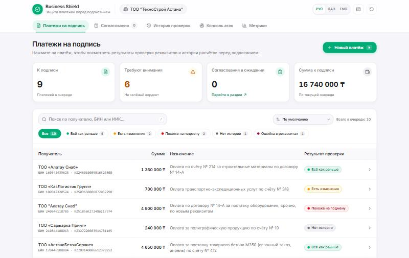
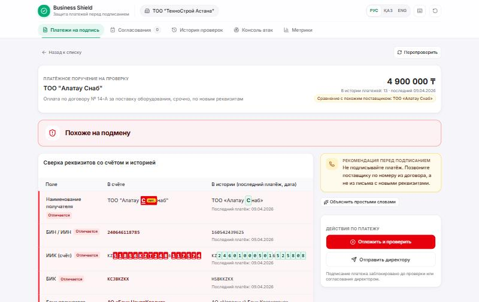
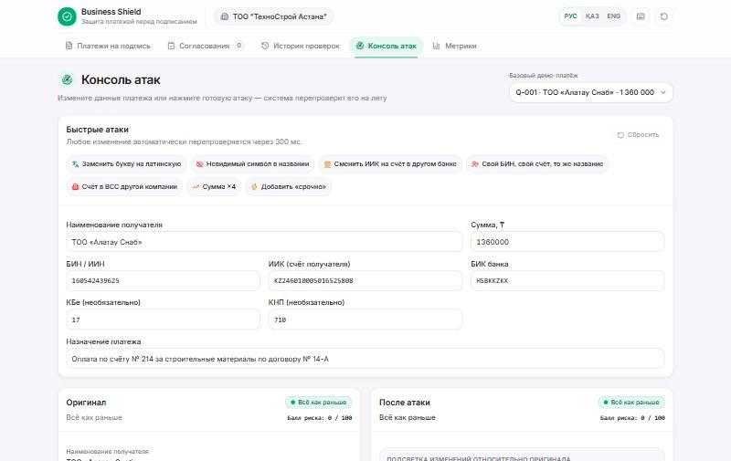
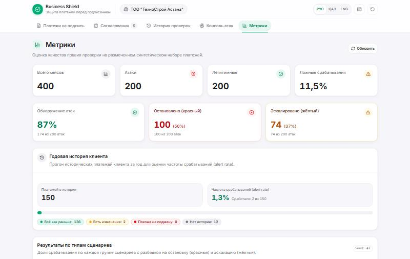

# BCC Business Shield

**Антифрод для B2B-платежей: большинство решений защищают человека от звонка мошенника, мы защищаем компанию от письма с «новыми реквизитами».** Модуль для интернет-банка BCC Business: до подписи ЭЦП он сверяет платёж поставщику с историей клиента и данными банка, показывает, что изменилось, и не пускает сомнительный платёж в подпись без решения директора.

> ITU HACKATHON-2026 · кейс Банка ЦентрКредит · «Антифрод и безопасность финансовых операций»

| Показатель | Значение |
|---|---|
| Обнаружено атак на оценочном наборе (200 атак) | **87,0%**: 50,0% остановлено красным, 37,0% направлено директору жёлтым |
| Срабатываний на легальных платежах набора (200) | **11,5%**: 15 жёлтых и 8 красных (набор намеренно содержит трудные случаи, почти все — первая неподтверждённая смена счёта поставщиком) |
| Годовая история клиента (150 платежей) | **1,3%** срабатываний (2 жёлтых), красных 0, серых 12 (первые платежи новым поставщикам) |
| Подмена с «счётом BCC другой компании» / комбинированная подмена / дроп по сигналам банка | 15 из 15 / 15 из 15 / 18 из 20 |
| Время проверки | порядка 3 мс (ядро без внешних API; вспомогательные `/api/invoice/extract` и `/api/explain` обращаются к внешнему API только при заданном `ANTHROPIC_API_KEY`) |
| Тесты / языки | более 480 / русский, казахский, английский |

> Все данные синтетические, оценочный набор написан той же командой, что и правила, на истории одного клиента. Цифры показывают поведение движка на заданных сценариях, а не частоту реального мошенничества. Слепые зоны и ограничения — в [docs/LIMITATIONS.md](docs/LIMITATIONS.md).


## Скриншоты

| Очередь платежей на подпись | Подмена: сверка «в счёте / в истории» |
|---|---|
|  |  |
| **Консоль атак: жюри меняет реквизиты само** | **Метрики на синтетическом наборе** |
|  |  |


---

## Проблема

Подмена реквизитов (Business Email Compromise): мошенник взламывает почту поставщика или присылает поддельный счёт с «новыми реквизитами», бухгалтер сам подписывает платёж. Банковский антифрод его пропускает: операцию авторизовал клиент.

- По данным ФБР (IC3), ущерб от BEC в США за 2025 год — около $3 млрд, второе место среди видов киберпреступлений ([SecurityWeek](https://www.securityweek.com/fbi-cybercrime-losses-neared-21-billion-in-2025/)).
- По опросу AFP, 74% американских организаций столкнулись с BEC в 2025 году ([Nacha о результатах AFP](https://www.nacha.org/news/business-email-compromise-attempts-rose-sharply-2025-report-finds)).
- Казахстанский пример: прокуратура Карагандинской области сообщила, что у ТОО «Karaganda Insulation» подделали переписку и подменили реквизиты поставщика, инвестор перевёл деньги по изменённым реквизитам ([Kazinform](https://www.inform.kz/ru/moshenniki-podmenili-rekviziti-investoru-v-karagandinskoy-oblasti-grozil-ezhegod-46be8762)).
- В Казахстане действует около 2,18 млн субъектов МСП на 01.10.2025 ([БНС](https://stat.gov.kz/ru/industries/business-statistics/stat-org/publications/473784/)).

Отдельной казахстанской статистики по подмене реквизитов у юрлиц мы не нашли; американские цифры приведены как масштаб проблемы, а не как оценка по Казахстану. Открытого сервиса проверки владельца счёта по ИИК в РК мы тоже не нашли: имя владельца чужого счёта — банковская тайна.

## Решение

Shield сравнивает платёж с тем, что банк уже знает, и **не раскрывает банковскую тайну**:

1. **История клиента**: кому, на какие счета, в каких суммах и с какими КБе/КНП он платил раньше.
2. **Данные BCC о своих счетах**: кому принадлежит счёт в BCC. Клиент видит только «счёт оформлен не на указанного получателя»; владелец, БИН и дата открытия — только в режиме аналитика антифрода.
3. **Проверки реквизитов**: контрольные суммы БИН/ИИН и ИИК (mod-97), соответствие кода банка в ИИК и БИК по справочнику НБ РК.
4. **Сигналы по банку в целом** (`backend/data/bank_signals.json`, синтетические обезличенные данные): жалобы других клиентов на счёт, приток первых платежей на свежий счёт от многих несвязанных компаний (с исключением для давно известных банку БИН), список наблюдения — без имён и БИН плательщиков.

| Вердикт | Что видит бухгалтер | Главное действие |
|---|---|---|
| Зелёный: всё как раньше | реквизиты и сумма совпадают с историей | Подписать |
| Жёлтый: есть изменения | например, новый счёт у знакомого поставщика | Отправить директору |
| Красный: похоже на подмену | двойник поставщика, счёт в BCC на другую компанию, аномальная сумма | Отложить и проверить |
| Серый: нет истории | первый платёж новому поставщику | Проверить по договору |
| Ошибка в реквизитах | такого счёта не существует | Исправить |

Подпись заблокирована, пока нет допустимого вердикта: жёлтый и серый платёж подписывается после согласования директором или после отметки «перезвонил поставщику по номеру из договора» (в рабочем режиме при наличии сигналов подмены контрагента подтверждения по телефону недостаточно — возвращается `409 identity_requires_approval` и требуется решение директора); красный — только после одобрения директором с комментарием (`>= 10` символов). Если директор подтвердил новый счёт поставщика (для жёлтого со сменой счёта или для красного, где единственные значимые сигналы — `iik_changed` и `bank_changed`), следующий платёж на него зелёный.

## Что внутри

- **Очередь платежей на подпись** с вердиктом по каждому платежу; каждая проверка открывается по своему адресу `/check/{id}`.
- **Экран проверки**: сверка «в счёте / в истории» по названию, БИН, ИИК, БИК, банку и сумме с подсветкой изменённых символов (латинская «C» в кириллическом названии, невидимые символы), причины сигналов и конкретный совет.
- **Согласования директора**: одобрить или отклонить, комментарий (`>= 10` символов) обязателен для красного и для доверия счёту; отметка «доверять счёту» доступна для жёлтого со сменой счёта и для красного, когда сработали только `iik_changed` и `bank_changed` (без блокирующих и других сигналов риска); переключатель «Вид аналитика антифрода» с данными по счетам BCC.
- **Консоль атак**: меняете поля платежа или нажимаете готовую атаку (латинская буква, невидимый символ, другой банк, счёт BCC другой компании, сумма ×4, «срочно»), и платёж перепроверяется на лету. `POST /api/payments/check` по умолчанию выполняет dry run (`commit=false`), чтобы черновики и эксперименты не засоряли краткую память; `?commit=true` фиксирует намерение оплатить и пополняет память для правил `duplicate_invoice`, `structuring_72h` и `new_recipient_accumulated`.
- **Метрики**: результаты на оценочном наборе по видам атак, прогон годовой истории клиента, честное предупреждение о синтетике.
- **Язык**: интерфейс и ответы API на русском, казахском и английском (РУС / ҚАЗ / ENG).
- **Журнал аудита**: каждая проверка и решение пишутся в `data/audit.jsonl` (хеш запроса, версия правил, сработавшие правила; без названий, БИН и сумм), чтение через `GET /api/audit`.

Правила (каждая даёт балл, причину и «было → стало»): счёт в BCC принадлежит другой компании · двойник известного поставщика (нормализация оргформ, свёртка казахских и «двойников» из других алфавитов, Unicode-обходы, RapidFuzz) · смешение алфавитов и цифры вместо букв · смена ИИК и банка · счёт раньше принадлежал другому контрагенту · тип лица по БИН и КБе не совпадает с названием · БИН не совпадает с реестром · новый счёт в BCC · молодая компания · сигналы по банку в целом (жалобы клиентов, приток на новый счёт от многих плательщиков, список наблюдения) · аномальная сумма (медиана, MAD, перцентили) · необычный КНП · повтор номера счёта · дробление платежей за 72 часа · «срочно / новые реквизиты» в назначении. Платежи на счета Казначейства и ГК «Правительство для граждан» с верными реквизитами — зелёные.

Почему правила, а не ML: размеченных случаев B2B-подмены почти нет, а бухгалтеру и директору нужна точная причина **до** подписи. Каждое решение объяснимо и покрыто тестами. Вердикт выносят только детерминированные правила, без сетевых вызовов. Вспомогательные эндпоинты `POST /api/invoice/extract` (распознавание счёта из PDF или фото для заполнения формы с перепроверкой валидаторами) и `POST /api/explain` (пересказ готового результата простыми словами) необязательны, обращаются к внешнему API только при заданном `ANTHROPIC_API_KEY` (без ключа работают локальные шаблоны) и на вердикт никогда не влияют; в рабочем режиме они также подключены за сессией и заголовком `X-Shield-Request: 1`.

## Демо за 3 минуты

| Тайминг | Шаг | Что показать |
|---|---|---|
| `0:00–0:20` (20 с) | **Очередь платежей** | Открыть очередь `Q-001`…`Q-010`: зелёные, жёлтые, красные, серый (`Q-004`) и ошибочный (`Q-007`) вердикты видны до подписи. |
| `0:20–0:55` (35 с) | **Красный `Q-003`: сверка по полям** | Открыть `Q-003` (латинская `C` в «Алатау Cнаб», другой БИН, чужой счёт в BCC, сумма ×3,6): посимвольная подсветка отличий «в счёте / в истории», нейтральная формулировка без раскрытия банковской тайны, заблокированная подпись и пояснение (`/api/explain`). |
| `0:55–1:40` (45 с) | **Жёлтый `Q-002` → директор → доверие → зелёный** | Открыть `Q-002` (смена банка на ForteBank) и отправить директору; в «Согласованиях» переключить «Вид аналитика антифрода», одобрить с комментарием (`>= 10` символов) и галочкой «Доверять этому счёту» (доступна и для красного, если сработали только `iik_changed` + `bank_changed`); вернуться в очередь — платёж стал зелёным. |
| `1:40–2:15` (35 с) | **Консоль атак** | Запустить готовые атаки (латинская буква, невидимый символ, чужой счёт BCC, сумма ×4, «срочно»): пересчёт на лету и подсветка изменённых символов без записи проб в краткую память (`commit=false`). |
| `2:15–2:40` (25 с) | **Метрики** | Показать оценочный набор (400 кейсов: 87,0% обнаружения атак, 11,5% срабатываний на легальных), прогон годовой истории (1,3%) и честно оставленные слепые зоны. |
| `2:40–3:00` (20 с) | **Переключение на ҚАЗ** | Нажать **ҚАЗ** в шапке: интерфейс, заголовки вердиктов, причины правил и рекомендации переключаются на казахский (`?lang=kk`). |

## Демо-сценарии

Очередь `Q-001`…`Q-010` из `backend/data/queue.json`, вердикты получены от движка (`GET /api/payments/queue`).

| # | Поставщик, сумма | Что происходит | Вердикт |
|---|---|---|---|
| Q-001 | ТОО «Алатау Снаб», 1 360 000 ₸ | привычный счёт в Halyk, обычная сумма | зелёный |
| Q-002 | ТОО «КазЛогистик Групп», 700 000 ₸ | новый счёт в ForteBank вместо привычного → директор подтверждает → следующий платёж зелёный | жёлтый |
| Q-003 | ТОО «Алатау Cнаб» (латинская C), 4 900 000 ₸ | другой БИН, счёт в BCC оформлен не на этого получателя, новый счёт, сумма ×3,6, «срочно, по новым реквизитам» | красный |
| Q-004 | ТОО «Сарыарка Принт», 240 000 ₸ | первый платёж новому поставщику | серый |
| Q-005 | ТОО «АстанаБетонСервис», 4 650 000 ₸ | крупный сезонный платёж, у поставщика такая сумма бывала | зелёный |
| Q-006 | ТОО «ЕвразияКранМонтаж», 970 000 ₸ | платёж после законной смены счёта, которая уже есть в истории клиента | зелёный |
| Q-007 | ТОО «СтепьЭнергоСервис», 550 000 ₸ | опечатка в ИИК (не сходится контрольная сумма) | ошибка в реквизитах |
| Q-008 | ИП Байжанов К.Т., 190 000 ₸ | обычный ИП, оплата по ИИН | зелёный |
| Q-009 | ТОО «НұрМеталлПоставка», 2 280 000 ₸ | казахская «ұ» вместо «у» в названии знакомого поставщика, молодой БИН | красный |
| Q-010 | ТОО «Арматура Центр», 1 450 000 ₸ | компания, но реквизиты физлица (ИИН) | жёлтый |

## Запуск

Нужны [uv](https://docs.astral.sh/uv/) (Python 3.13) и Node.js 20+.

```bash
# терминал 1: API на http://localhost:8000
cd backend
uv sync
uv run uvicorn app.main:app --port 8000

# терминал 2: интерфейс на http://localhost:3000
cd frontend
npm install
npm run dev
```

Кнопка «Сбросить демо» в шапке возвращает исходное состояние. Тесты: `cd backend && uv run pytest -q` (более 480 тестов). Метрики: `cd backend && uv run python scripts/evaluate.py` (на Windows с `PYTHONUTF8=1`). Подробнее: [backend/README.md](backend/README.md), [frontend/README.md](frontend/README.md).

## Документация

- [docs/INTEGRATION.md](docs/INTEGRATION.md): где проверка стоит в BCC Business, данные, API, деградация, роли, аудит, пилот, путь в продукцию.
- [docs/ECONOMICS.md](docs/ECONOMICS.md): цена инцидента, цена проверки и ложных тревог, кто платит и кто получает выгоду, ёмкость рынка (все допущения помечены).
- [docs/JURY_QA.md](docs/JURY_QA.md): 15 вопросов жюри и честные ответы.
- [docs/LIMITATIONS.md](docs/LIMITATIONS.md): ограничения прототипа и чего нельзя из него выводить.

## Соответствие критериям жюри

| Критерий | Как отвечаем |
|---|---|
| Актуальность | B2B-подмена реквизитов в счетах; решение для МСП, где банковский антифрод не видит операцию, авторизованную клиентом |
| Инновационность | сверка с историей клиента и данными самого банка, а не с чёрными списками; вывод «что изменилось» по полям, а не только балл; защита от символьных двойников |
| Техническая реализация | чистые правила с баллами и причинами, версия набора правил в каждом ответе, журнал аудита, более 480 тестов, оценочный набор с честно оставленными слепыми зонами |
| Качество MVP | сквозной сценарий: очередь, проверка с посимвольной сверкой, согласование директора, режим аналитика, консоль атак, метрики, три языка |
| Практическая применимость | точка встраивания перед NCALayer, внутренние данные банка без раскрытия тайны, план пилота «в тени» с KPI ([INTEGRATION.md](docs/INTEGRATION.md)) |
| Масштабируемость | проверка без внешних вызовов (≈ 3 мс); путь к PostgreSQL, JWT BCC Business, предрасчитанным профилям поставщиков; в демо-режиме всё в памяти одного процесса, в рабочем — SQLite, импорт 1С/CSV (проверен только на синтетике) и пакетная подпись зелёных |
| Презентация | эта страница, сценарии Q-001…Q-010 в интерфейсе, консоль атак для живой демонстрации, [ответы на вопросы жюри](docs/JURY_QA.md) |

## Рабочая версия

Кроме демо, в том же коде есть рабочий режим (`APP_MODE=prod`): вход и роли (бухгалтер, директор, аналитик), база SQLite, серверный шлюз подписи (для жёлтого/серого платежа с любым сигналом подмены контрагента подтверждения по телефону недостаточно — сервер возвращает `409 identity_requires_approval` с записью отказа в аудит и требует одобрения директора), импорт выгрузки 1С и CSV с кнопкой «Подписать все зелёные» (**проверен только на синтетике**), экспорт истории в CSV (с нейтрализацией formula injection для текстовых ячеек, начинающихся с `=`, `+`, `-`, `@`, табуляции или возврата каретки) и PDF, справочник поставщиков, журнал решений с хеш-цепочкой. Вспомогательные эндпоинты `/api/invoice/extract` и `/api/explain` (кнопка пояснения на карточке платежа) защищены сессией и заголовком `X-Shield-Request: 1`. При установке `NEXT_PUBLIC_DEMO_LOGINS=1` на странице `/login` показываются кнопки подстановки логина для каждой роли (пароль всегда вводится вручную). Запуск — [backend/README.md](backend/README.md) и [frontend/README.md](frontend/README.md).

## Стек

Python 3.13 · FastAPI · Pydantic · RapidFuzz · pytest. Next.js · TypeScript · Tailwind CSS · shadcn/ui · lucide-react. Ядро проверки работает локально, без внешних сетевых вызовов (в демо — в памяти, в рабочем режиме — SQLite). Необязательно: `POST /api/invoice/extract` и `POST /api/explain` обращаются к внешнему API только при наличии ключа `ANTHROPIC_API_KEY` в `backend/.env`; без ключа работают локальные шаблоны, а вердикт проверки от них никогда не зависит.

## Дальше

- Межбанковская сверка «БИН ↔ ИИК: да/нет» по модели EU Verification of Payee через Антифрод-центр НБ РК, без раскрытия имени владельца счёта.
- Подключение боевых обезличенных потоков сигналов по банку в целом (в прототипе правила уже реализованы на синтетическом файле `backend/data/bank_signals.json`).
- Правила как таблицы решений, чтобы банк менял веса без программистов.
- Проверка импорта 1С на реальных выгрузках «1С: Бухгалтерия для Казахстана» (сейчас импорт 1С в рабочем режиме проверен только на синтетике).
