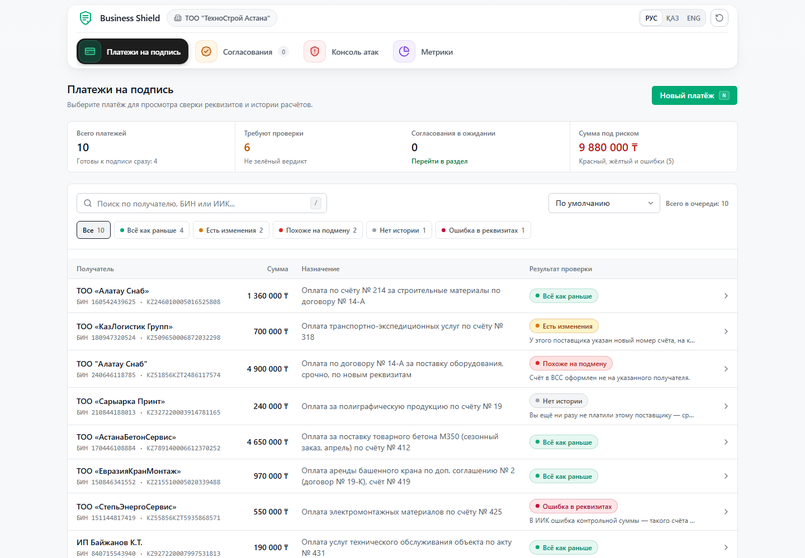
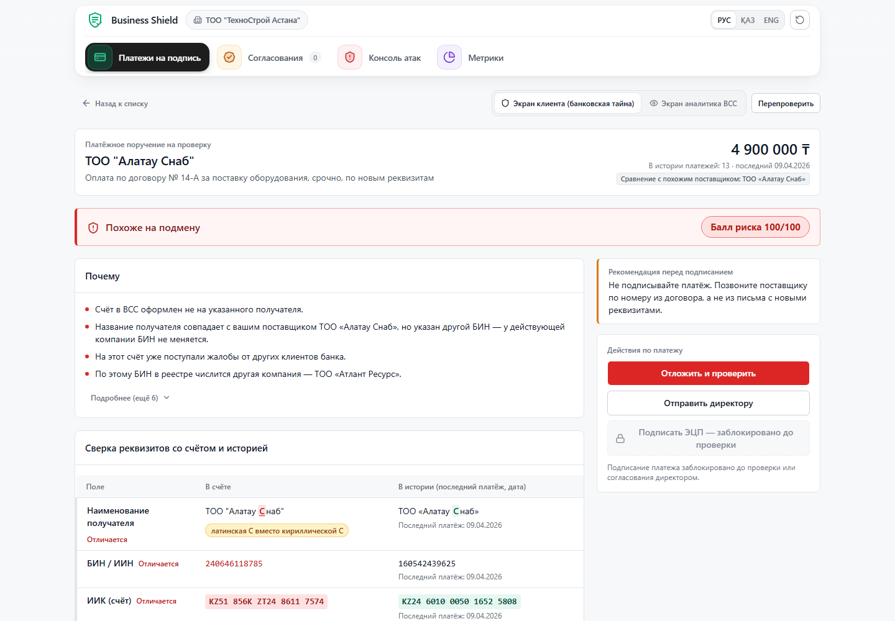
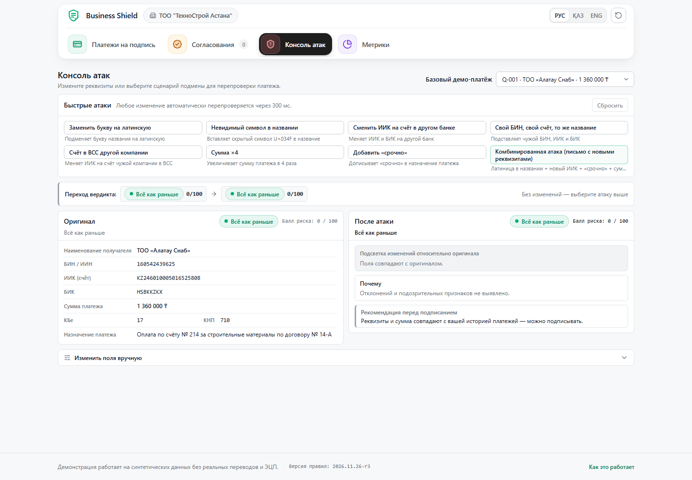
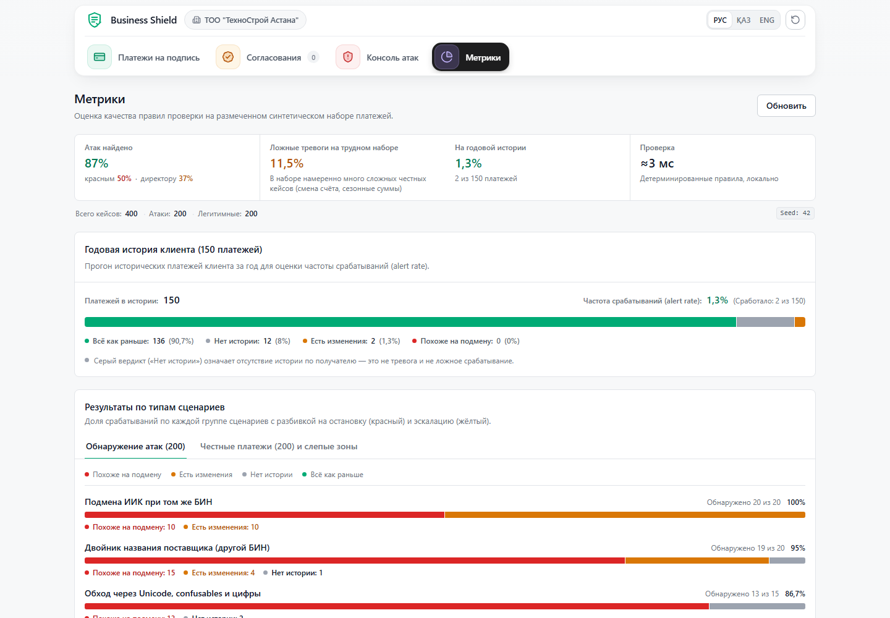

# BCC Business Shield

**Большинство решений защищают человека от звонка мошенника. Мы защищаем компанию от письма с «новыми реквизитами».**

Модуль для интернет-банка BCC Business: до подписи ЭЦП сверяет платёж поставщику с историей клиента и данными банка, показывает, что изменилось, и не пускает сомнительный платёж в подпись без решения директора.

> ITU HACKATHON-2026 · кейс Банка ЦентрКредит · «Антифрод и безопасность финансовых операций»

| Показатель (синтетический набор) | Значение |
|---|---|
| Атак обнаружено | **87,0%** (50,0% остановлено красным, 37,0% — директору) |
| Срабатываний на трудных честных платежах | **11,5%** |
| Срабатываний на годовой истории клиента | **1,3%**, красных 0 |
| Время проверки | ≈ 3 мс, локально |
| Тесты / языки | более 900 / русский, казахский, английский |

## Скриншоты

| Очередь платежей на подпись | Подмена: сверка «в счёте / в истории» |
|---|---|
|  |  |
| **Консоль атак** | **Метрики** |
|  |  |

## Как это работает

Shield сравнивает платёж с тем, что банк уже знает: историей платежей клиента, собственными счетами BCC и сигналами по банку в целом. Банковская тайна не раскрывается: клиент видит «счёт оформлен не на указанного получателя», детали — только антифрод-аналитик банка.

| Вердикт | Пример | Действие |
|---|---|---|
| Зелёный | всё как раньше | Подписать |
| Жёлтый | новый счёт у знакомого поставщика | Отправить директору |
| Красный | двойник поставщика, чужой счёт в BCC, аномальная сумма | Отложить и проверить |
| Серый | первый платёж новому поставщику | Проверить по договору |

Вердикт выносят только объяснимые правила: каждая причина видна бухгалтеру и директору до подписи.

## Запуск

```bash
docker compose up --build        # демо: http://localhost:3000
docker compose --profile prod up --build backend-prod frontend-prod   # рабочий режим со входом и ролями
```

Без Docker и подробности — [docs/DOCKER.md](docs/DOCKER.md), [backend/README.md](backend/README.md), [frontend/README.md](frontend/README.md).

## Документация

- [docs/OVERVIEW.md](docs/OVERVIEW.md) — проблема, правила, демо-сценарии, рабочий режим, соответствие критериям
- [docs/INTEGRATION.md](docs/INTEGRATION.md) — встраивание в BCC Business и пилот
- [docs/ECONOMICS.md](docs/ECONOMICS.md) — экономика
- [docs/JURY_QA.md](docs/JURY_QA.md) — вопросы и ответы
- [docs/LIMITATIONS.md](docs/LIMITATIONS.md) — границы MVP и план развития

Данные синтетические; реальную частоту срабатываний покажет пилот на данных BCC.
